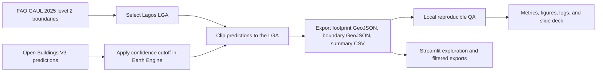

# Project 2 — Lagos building footprint mapping

> **Purpose of this file:** A complete, fact-checked project brief for writing a report, preparing slides, or asking an AI assistant questions about this repository. Treat it as the starting point, then verify detailed methods and current figures against the linked source files. Do not describe model predictions as ground truth or as measured accuracy.

## 1. Project identity

- **Project title:** Project 2 — Lagos building footprint mapping
- **Project type:** Cloud-first geospatial data export, quality assurance, and interactive exploration
- **Current study area:** Ikeja Local Government Area (LGA), Lagos State, Nigeria
- **Intended scope:** Selectable Lagos LGAs; the supplied and locally audited export is Ikeja
- **Data product:** Existing building-footprint predictions from Google Research Open Buildings V3 clipped to a selected Lagos LGA
- **Model training:** None. The project does not train a U-Net or another model.
- **Current repository folder:** `building-footprints-unet` is a legacy name and does not accurately describe the current Lagos-only workflow. The clearer proposed name is `lagos-building-footprint-mapping`. The GitHub remote still points to `IyinoluwaDon/Building-footprints-unet` until its owner renames it.

## 2. Executive summary

This project makes an existing building-footprint prediction layer easier to explore and audit for Lagos. A Google Colab notebook uses Google Earth Engine (GEE) to select an LGA from the FAO Global Administrative Unit Layers (GAUL) 2025 level 2 boundary data, filter Google Research Open Buildings V3 by a user-selected confidence cutoff, clip the results to the selected LGA, and export the footprint layer, matching study boundary, and provenance summary to Google Drive. A local Python audit then checks the exported data and produces reproducible reports and figures. A Streamlit application lets technical and nontechnical users explore the supplied Ikeja export, filter it, inspect attributes, and download or save subsets.

The current supplied export contains **53,437 predicted footprints** for Ikeja at confidence **≥ 0.75**. The metadata reports a study area of **46.0156 km²**. Structural, score, identifier, coordinate, area, and topology checks passed. The matching boundary GeoJSON was absent from the supplied local files, so independent containment against that boundary has **not been verified**. No local reference labels or field survey were supplied, so the project cannot report precision, recall, completeness, or local building-detection accuracy.

## 3. Why the project exists

Buildings are important features in urban mapping and planning. A reusable footprint layer can support exploratory mapping and downstream analysis, but a raw prediction layer is not automatically trustworthy, understandable, or ready to present. The project addresses a practical workflow problem: how to obtain a manageable Lagos LGA subset from a large cloud-hosted geospatial dataset, preserve its provenance, inspect the export, and explain what the results can and cannot support.

The resource-conscious choice is to process the source collection in Earth Engine and export only the chosen area and confidence-filtered predictions. The workflow avoids downloading a 26 GB imagery archive for this use case. The current analysis reuses published predictions; it is not a new building-detection experiment.

## 4. Research question, aim, and objectives

### Research question

**What building footprints does Open Buildings V3 predict within a selected Lagos LGA at a chosen confidence cutoff, and what can be verified about the resulting export?**

### Aim

Build a transparent and reproducible workflow to select, export, audit, explore, and present Open Buildings V3 footprint predictions for a Lagos LGA.

### Objectives

1. Select a Lagos LGA from an administrative boundary dataset rather than hard-code only one area.
2. Choose a confidence cutoff and filter the source predictions in Earth Engine.
3. Clip qualifying predictions to the selected LGA and export the footprints, exact boundary, and summary metadata.
4. Check export counts, confidence values, feature identifiers, coordinate/ring structure, areas, and geometry validity locally.
5. Make results understandable through documented metrics, figures, logs, a slide deck, and a technical/nontechnical dashboard.
6. State evidence gaps clearly and avoid unsupported claims about accuracy or completeness.

## 5. What the project does and does not do

### It does

- Reuse the published Google Research Open Buildings V3 prediction layer.
- Support selection of a Lagos LGA and a configurable confidence threshold in the Earth Engine notebook.
- Clip predictions to the selected study boundary in Earth Engine.
- Export a GeoJSON footprint collection, matching boundary GeoJSON, and one-row CSV metadata to Google Drive.
- Audit local exports and save QA outputs, input fingerprints, logs, and figures.
- Present the supplied Ikeja results and let users inspect/filter/download subsets through Streamlit.

### It does not

- Train, fine-tune, or evaluate a U-Net or another detection model.
- Create new imagery annotations or independent ground truth.
- Validate predictions using field surveys or a locally curated reference dataset.
- Establish precision, recall, completeness, omission/commission error, or local accuracy.
- Produce a complete or authoritative building register/census.
- Treat the sum of individual feature areas as dissolved land coverage.

## 6. Data and provenance

| Item | Current project setting |
|---|---|
| Footprint source | Google Research Open Buildings V3 Earth Engine collection: `GOOGLE/Research/open-buildings/v3/polygons` |
| Source inference year | 2023, as recorded in the supplied summary CSV |
| Administrative boundary | FAO GAUL 2025 level 2 Earth Engine collection: `FAO/GAUL/2025/level2` |
| State/study region | Lagos State, Nigeria |
| Current selected LGA | Ikeja |
| Current export threshold | Confidence ≥ 0.75 |
| Coordinate reference | WGS 84 longitude/latitude (EPSG:4326) |
| Footprint attributes | Feature ID, `confidence`, and `clipped_area_m2` |
| Declared source license | CC BY 4.0, recorded in the export summary |
| Drive export folder | `My Drive/Lagos_Open_Buildings/` |

For reuse, credit Google Research Open Buildings V3 and FAO GAUL 2025 under CC BY 4.0. See the [Open Buildings V3 Earth Engine catalog page](https://developers.google.com/earth-engine/datasets/catalog/GOOGLE_Research_open-buildings_v3_polygons) and [FAO GAUL 2025 level 2 catalog page](https://developers.google.com/earth-engine/datasets/catalog/FAO_GAUL_2025_level2) for source descriptions and terms.

The Earth Engine notebook requires the user's Earth Engine-enabled Google Cloud Project ID and Google account authentication in Colab. Do not put credentials, tokens, or keys in this repository. The notebook exports to the authenticated user's Google Drive; the local Streamlit application does not upload the data it reads.

## 7. Workflow: end to end



### Cloud export steps

1. Open `notebooks/lagos_open_buildings_gee.ipynb` in Google Colab.
2. Authenticate to Earth Engine and provide the Earth Engine-enabled Cloud Project ID.
3. Load the GAUL 2025 level 2 collection and choose a Lagos LGA. Ikeja is the default.
4. Choose a confidence threshold from 0.00 to 1.00 (default 0.75, in 0.01 increments).
5. Filter Open Buildings V3 server-side, preview the filtered layer, and export geometries clipped to the chosen LGA.
6. Wait for the Earth Engine export task to complete in Drive.
7. Export the matching boundary GeoJSON and summary CSV. The notebook's lightweight final cell can refresh these metadata outputs without repeating the large footprint export.

Expected export names are similar to:

- `<LGA>_open_buildings_conf<TAG>.geojson`
- `<LGA>_boundary_gaul2025.geojson`
- `<LGA>_open_buildings_conf<TAG>_summary.csv`

The exports land in `My Drive/Lagos_Open_Buildings/`. The GeoJSON and matching CSV (and boundary when available) are placed together under `results/lagos/` for local analysis.

### Local QA

`results/lagos/analyze_export.py` checks the GeoJSON collection and summary CSV for consistency, including feature counts, confidence score ranges and cutoff, unique IDs, finite WGS 84 coordinates, closed rings, positive clipped areas, supported geometries, and valid polygon topology. When the matching boundary file is supplied, the audit also checks exact containment. The tool records input hashes and software versions and produces Markdown, JSON, logs, and figures.

### Interactive app

`app.py` is a local Streamlit dashboard for both general and technical audiences. It opens with the supplied Ikeja export and includes:

- an overview with prediction count, study area, median confidence, and median feature area;
- an interactive map of footprint locations (map points are approximate bounding-box centers; large exports are sampled for the map, while headline counts remain exact);
- a confidence distribution and source/export details;
- an Explore view for attribute previews and downloadable filtered GeoJSON/CSV;
- an explicit option to save filtered outputs to `results/interactive/` with a run record and SHA-256 fingerprints;
- a Technical QA view with structural checks, input fingerprints, and an optional exact-boundary check when the matching boundary GeoJSON is uploaded;
- a Guide view explaining the terms, process, and limitations.

The app's confidence slider only filters features already present in the loaded export. It cannot retrieve predictions that were excluded by the original Earth Engine cutoff. The base map uses CARTO assets and therefore requires an internet connection to render the background tiles. The app itself runs locally and does not upload the data.

## 8. Current results: supplied Ikeja export

These are results from the local source export and its summary CSV, not results from an independent accuracy evaluation.

| Measure | Result | Interpretation |
|---|---:|---|
| Reported boundary area | 46.0156 km² | Metadata value for the selected LGA boundary |
| Predicted footprint features | 53,437 | Number of exported features at confidence ≥ 0.75; not a census |
| Prediction count per reported km² | 1,161.3 | Descriptive count density; not population density or completeness |
| Confidence mean | 0.8536 | Model score summary, not measured accuracy |
| Confidence median | 0.8575 | Model score summary, not probability of correctness |
| Confidence range | 0.7500–0.9747 | Observed scores in the export |
| Confidence 0.75–0.80 | 12,628 (23.63%) | Exported feature distribution |
| Confidence 0.80–0.85 | 12,142 (22.72%) | Exported feature distribution |
| Confidence 0.85–0.90 | 13,945 (26.10%) | Exported feature distribution |
| Confidence 0.90–0.95 | 14,057 (26.31%) | Exported feature distribution |
| Confidence 0.95–1.00 | 665 (1.24%) | Exported feature distribution |
| Median clipped feature area | 124.1 m² | Per-feature area statistic |
| 90th percentile clipped feature area | 399.7 m² | Per-feature area statistic |
| Maximum clipped feature area | 19,394.0 m² | Largest single exported feature |
| Sum of per-feature clipped areas | 11.854 km² | Non-dissolved sum; overlaps can count more than once; not coverage |
| Geometry types | 53,434 Polygon; 3 MultiPolygon | Feature type totals |

### QA status

**Passed:** count matches the summary CSV; confidence values are within the unit interval and meet the source cutoff; all clipped feature areas are positive; feature IDs are unique; geometries are present; rings are closed; coordinates are WGS 84; polygon topology is valid.

**Not verified:** exact containment against the selected Ikeja boundary. The matching GAUL boundary GeoJSON is absent from the supplied local export. The Earth Engine notebook can export it; rerun the local audit with that matching file to close this gap.

**Not evaluated:** local detection accuracy. No independent reference labels, sample design, field verification, precision, recall, or completeness analysis is included.

## 9. Interpretation and reporting language

Recommended phrasing:

> “The workflow exported 53,437 Open Buildings V3 building-footprint predictions within the Ikeja study area at a source-model confidence cutoff of 0.75. Export-level geometry and metadata checks passed. Exact containment against the matching administrative boundary has not yet been independently verified, and no local reference dataset was available to estimate detection accuracy.”

Avoid statements such as:

- “Ikeja has exactly 53,437 buildings.”
- “The model is 85.75% accurate.”
- “25.76% of Ikeja is covered by buildings” based on the raw feature-area sum.
- “All detected buildings are correct” or “the map is complete.”

The score is a model confidence output. Its median is not accuracy, and it has not been calibrated as a probability of local correctness. A count of predictions is not a census. An undissolved sum of feature areas is not a coverage measurement because overlaps have not been removed.

## 10. Reproduction and tools

### Local analysis and existing unit tests

From the repository root:

```powershell
python -m pip install -r results/lagos/requirements-analysis.txt
python results/lagos/analyze_export.py
python -m unittest discover -s tests -v
```

For a different Lagos LGA export, pass its matching GeoJSON, summary CSV, and (for boundary containment) boundary GeoJSON to `analyze_export.py`. The script supports options for report, JSON, log, and presentation output paths; use `python results/lagos/analyze_export.py --help` to see them.

### Run the dashboard

```powershell
python -m venv .venv
.venv\Scripts\Activate.ps1
python -m pip install -r requirements-app.txt
streamlit run app.py
```

Use **Save filtered outputs into results/interactive** in the Explore view to retain a filtered GeoJSON, attribute CSV, and provenance/run JSON in the project. These generated datasets are ignored by Git by default to prevent accidental commits of duplicate large exports.

### Verification recorded in the repository

- Seven existing Python unit tests pass. See `results/lagos/unit_tests.log`.
- The Streamlit app smoke check passes: default Ikeja data loaded without app exceptions, the dashboard showed 53,437 predictions, and four audience views were available. See `results/lagos/streamlit_app_smoke.log`.
- The full current export audit is in `results/lagos/QA_REPORT.md`, with machine-readable metrics in `results/lagos/qa_summary.json` and run output in `results/lagos/qa_run.log`.

The smoke check uses Streamlit's in-process `AppTest`; the app server was not left running. A user can start it with `streamlit run app.py`.

## 11. Project files and where to find things

| Path | Purpose |
|---|---|
| `README.md` | Short repository overview, setup, quick start, and app instructions |
| `docs/PROJECT_MASTER_SUMMARY.md` | Full chatbot/report/slide reference for project context and verified findings |
| `docs/PROJECT_OVERVIEW.md` | Concise research question, objectives, workflow, scope, and assessment |
| `docs/METHOD_AND_REPRODUCIBILITY.md` | Detailed cloud export, local QA, commands, and deterministic/interpretive notes |
| `docs/ASSESSMENT.md` | Project-quality rubric and next evidence needed |
| `notebooks/lagos_open_buildings_gee.ipynb` | Lagos LGA selector and Earth Engine export workflow for Google Colab |
| `app.py` | Local Streamlit results explorer |
| `requirements-app.txt` | Pinned dashboard dependencies |
| `.streamlit/config.toml` | App's native visual theme |
| `results/lagos/Ikeja_open_buildings_conf075.geojson` | Supplied source footprint export (~21.2 MB) |
| `results/lagos/Ikeja_open_buildings_conf075_summary.csv` | One-row source metadata and reported boundary area |
| `results/lagos/Ikeja_boundary_gaul2025.geojson` | **Not supplied yet**; required for independent local boundary check |
| `results/lagos/analyze_export.py` | Local export analysis, QA checks, and figure generation |
| `results/lagos/DATA_DICTIONARY.md` | Feature and summary field meanings |
| `results/lagos/QA_REPORT.md` | Human-readable current audit results and caveats |
| `results/lagos/qa_summary.json` | Machine-readable current QA metrics and statuses |
| `results/lagos/qa_run.log` | Audit run log |
| `results/lagos/unit_tests.log` | Existing unit test results |
| `results/lagos/streamlit_app_smoke.log` | Dashboard smoke test result |
| `results/presentation/Project_2_Lagos_Building_Footprint_Mapping.pptx` | Editable project presentation with speaker notes |
| `results/presentation/` | Generated presentation figures and slide narrative |
| `tests/test_analysis_helpers.py` | Unit tests for confidence binning and ring-coordinate validation |
| `results/interactive/` | Optional locally saved filtered app exports; Git-ignored by default |

## 12. Assessment and meaningful next upgrades

The current project assessment is **7/10 as a reproducible project demonstration**, not as a model-accuracy rating. Scope/provenance, reproducibility, quality checks, and presentation readiness are comparatively strong. Evidence for local detection accuracy is weak because no independent reference labels are supplied.

Recommended next upgrades, ordered by evidence value:

1. Export the exact Ikeja boundary from the same notebook run, store it beside the source GeoJSON/CSV, and rerun exact containment QA.
2. Define and document an independent reference sample (source/date, sampling design, inclusion criteria, annotator protocol, and quality control).
3. Compare predictions with that reference sample and report precision, recall, omission/commission errors, and uncertainty with clearly stated denominators.
4. If future work requires a newly trained model, define a separate supervised-learning scope with suitable high-resolution imagery, labels, spatial train/validation/test separation, and compute budget. This would be a new phase; it is not part of current results.

## 13. Short description for a report or slide

> This project develops a resource-conscious and reproducible workflow to extract, audit, and explore Google Research Open Buildings V3 footprint predictions for Lagos LGAs. Using Google Earth Engine, the workflow applies a configurable confidence threshold and clips outputs to a FAO GAUL 2025 level 2 boundary, then exports GeoJSON and provenance metadata for local QA and presentation. The supplied Ikeja export contains 53,437 predictions at confidence ≥ 0.75. Structural and geometry checks passed, while exact local boundary containment remains unverified because the matching boundary file is not present. The output is a prediction layer rather than an independently validated census; no local precision, recall, completeness, or accuracy estimate is claimed.

## 14. Suggested prompt for a future chatbot

> Read `docs/PROJECT_MASTER_SUMMARY.md` first, then consult the linked project files for details. Answer using only facts supported by this repository or clearly mark external background as external. Keep model confidence separate from measured accuracy; do not call predictions ground truth, a complete building census, or verified correct buildings. State that current supplied results are for Ikeja only, 53,437 features at cutoff ≥ 0.75, with exact containment against the matching boundary not verified and no independent local accuracy evaluation. When using numerical values, preserve their units and caveats. For report text or slides, include source attribution and the project's limitations.
