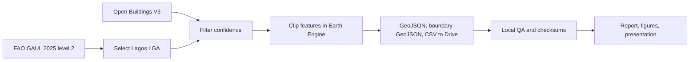

# Project 2: Lagos Building Footprint Mapping

## Project overview

This project produces a traceable building-footprint layer for one Lagos Local Government Area (LGA) at a time. It uses the existing Google Research Open Buildings V3 predictions in Google Earth Engine, clips them to the selected FAO GAUL 2025 level 2 boundary, and prepares a local audit and presentation package.

## Research question

**What building footprints does Open Buildings V3 predict within a selected Lagos LGA at a chosen confidence cutoff, and what can be verified about the resulting export?**

For the supplied Ikeja export, the cutoff is 0.75 and the dataset contains 53,437 predictions. These figures describe the supplied model output. They do not estimate local completeness or building-level accuracy.

## Objectives

1. Select a Lagos LGA from the boundary layer rather than hard-code one study area.
2. Explore a filtered footprint layer in a lightweight interactive preview.
3. Export clipped footprints, the exact boundary, and one-row provenance metadata to Google Drive.
4. Audit the exports locally for consistency, geometry integrity, confidence thresholds, and boundary containment when the boundary file is available.
5. Produce reproducible tables, figures, logs, and presentation materials.

## Workflow

## Supplied Ikeja result

- Reported boundary area: 46.016 km².
- Filtered footprint predictions: 53,437 at confidence ≥ 0.75.
- Median model confidence: 0.8575.
- Median clipped feature area: 124.1 m²; 90th percentile: 399.7 m².
- Geometry checks passed for the supplied GeoJSON, and its count matches the summary CSV.
- Exact containment against the LGA boundary is pending because the matching boundary GeoJSON was not in the supplied export.

## Scope and interpretation

This is a geospatial data processing and quality assurance project. It reuses an existing prediction layer; it does not train a neural network, create new imagery labels, or independently measure precision and recall. A confidence cutoff filters model outputs; it does not turn confidence into a calibrated probability of correctness. Feature count is not a building census. The sum of feature areas is not a coverage estimate because overlaps are not dissolved.

## Repository map

- `notebooks/lagos_open_buildings_gee.ipynb` — Earth Engine and Colab export workflow.
- `results/lagos/` — supplied source data, QA script, report, logs, data dictionary, and machine-readable metrics.
- `results/presentation/` — editable slide deck and generated figures.
- `tests/` — fast unit tests for confidence binning and geometry ring validation.
- `README.md` — setup, run steps, and reproduction commands.

## Current quality assessment

The project is reproducible for the supplied export and the workflow supports other Lagos LGAs and confidence cutoffs. The highest-value remaining research upgrade is validation against an independent, locally curated reference dataset; until that exists, results should be described as model-derived predictions.
