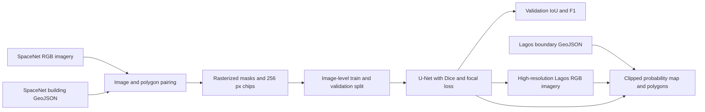

# Lagos Building Footprint Mapping with U-Net

## Project overview

This project combines a SpaceNet-based building-segmentation training pipeline with a Lagos-specific footprint export and audit workflow. The custom U-Net is designed to train from SpaceNet 2 AOI 2 Vegas RGB-PanSharpen imagery and polygon labels. Its inference workflow accepts compatible georeferenced Lagos imagery and clips predictions to a supplied Lagos boundary. Google Research Open Buildings V3 predictions remain a separately sourced Lagos baseline. The repository currently contains the training and inference code; no U-Net checkpoint or Lagos U-Net prediction has been generated yet.

## Research question

**How well does a U-Net trained on SpaceNet building polygons segment buildings in held-out SpaceNet images, and how does that model transfer to compatible high-resolution imagery inside Lagos?**

The training workflow reports image-held-out IoU and F1. Lagos transfer predictions are written as a georeferenced probability raster and boundary-clipped GeoJSON polygons.

## Objectives

1. Rasterize SpaceNet building polygons using each source image's CRS and transform.
2. Split training and validation by source image, then create paired 256 × 256 image and mask tiles.
3. Train a four-level U-Net using Dice plus focal loss and select the checkpoint by validation IoU.
4. Apply the selected checkpoint to compatible high-resolution Lagos imagery.
5. Clip probability rasters and vectorized footprints to a supplied Lagos boundary.
6. Retain the Open Buildings V3 export and local audit as a Lagos-specific baseline product.

## Workflow

## Supplied Ikeja Open Buildings result

The supplied Ikeja export contains 53,437 Google Research Open Buildings V3 predictions at a confidence cutoff of 0.75. These existing predictions are retained for comparison and are independent of the SpaceNet-trained U-Net.

## Model implementation

The architecture, mask preparation, training loop, checkpointing, and Lagos inference are implemented in `src/lagos_buildings/`. Preparation records the SpaceNet source image IDs and RGB normalization values. When run, training records epoch-level metrics and saves the best validation-IoU checkpoint. Inference processes one georeferenced image tile at a time and uses the checkpoint's normalization values.

## Repository map

- `src/lagos_buildings/model.py` — U-Net and Dice + focal loss.
- `src/lagos_buildings/prepare.py` — image/label matching, mask rasterization, source-image split, and tiling.
- `src/lagos_buildings/train.py` — model training, validation, and checkpoint selection.
- `src/lagos_buildings/predict.py` — tiled prediction, boundary clipping, and polygon output.
- `docs/MODEL_TRAINING.md` — model workflow and reproduction steps.
- `notebooks/lagos_open_buildings_gee.ipynb` — Google Earth Engine export for the existing Open Buildings baseline.
- `results/lagos/` — supplied Ikeja export and local QA artifacts.
- `app.py` — interactive viewer for the supplied Open Buildings export.
